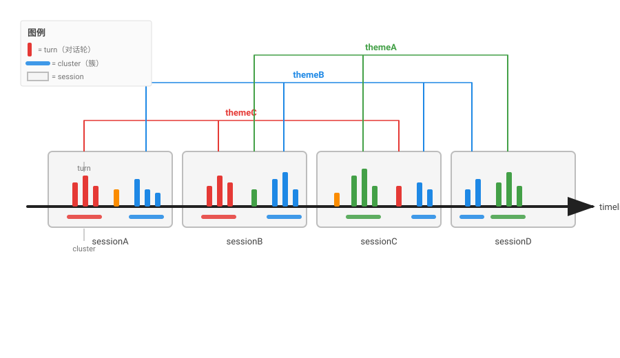

<div align="center">
  <picture>
    <source media="(prefers-color-scheme: dark)" srcset="./assets/banner-dark.svg" />
    <source media="(prefers-color-scheme: light)" srcset="./assets/banner-light.svg" />
    
  </picture>

  **Cross-session long-term memory for Kimi Code CLI — Markdown-first, auditable, owned by you**

  [中文](./README.md) · [Docs](./docs/ARCHITECTURE.md) · [Demo](#demo) · [Issues](https://github.com/Zehee/kimi-code-memory-mcp-server/issues)

  [](https://github.com/Zehee/kimi-code-memory-mcp-server/actions/workflows/ci.yml)
  [](https://www.npmjs.com/package/kimi-code-memory-mcp-server)
  [](https://www.npmjs.com/package/kimi-code-memory-mcp-server)
  [](https://nodejs.org/)
  [](./LICENSE)
</div>

A local stdio MCP server that gives [Kimi Code CLI](https://github.com/MoonshotAI/kimi-code) cross-session memory.

## Quickstart in 30 seconds

```bash
npm install -g kimi-code-memory-mcp-server
kimi-memory-setup
```

Restart `kimi web` and your agent gains cross-session memory: decisions, rules, and knowledge accumulate automatically and survive session switches. The memory dashboard also opens in your browser so you can see what the agent remembers. See [Install](#install) for more options.

## Demo

A real Kimi Code CLI session: the user asks for two cross-session summaries — the evolution of the MCP memory server, then the E2E testing tools. The agent recalls related memories and conversation turns across sessions and synthesizes structured answers.


How `kimi-memory` sees conversation history: vertical bars are turns on the timeline, thick horizontal lines are clusters, gray boxes are sessions, and colored brackets connect related turns across sessions into theme lines.



## Features

- **Markdown-first** — memories are readable, editable, and git-auditable instead of hidden in a black-box store.
- **Structured long-term memory** — organize decisions, rules, knowledge, and references, then distill a workspace essence.
- **Cross-session recovery** — read Kimi Code CLI's `wire.jsonl` directly to recover recent working context.
- **Theme tracing** — reconnect related turns across sessions to reconstruct how designs and decisions evolved.
- **Local and rebuildable** — Markdown is the source of truth and indexes are disposable; no external database or cloud service required.
- **Visual dashboard** — starts automatically with the MCP server; browse memories, theme timelines, and recent decisions in Chinese or English.

## Usage

Once configured, interact with your agent in natural language:

```text
User: We decided to use SQLite for the cache layer. Remember this decision.
Agent: [remember] Saves it to memory/decisions/

User: Why did we choose SQLite?
Agent: [search + recall] "Because the project needs to work offline without extra services..."

User: How has the cache design evolved?
Agent: [trace_theme] Brings together related discussions, decisions, and changes across sessions
```

## Why Kimi Memory?

### Remember how we got here, not just what happened recently

Traditional context management decays along a vertical timeline, while real work usually advances through several parallel themes. Theme tracing scans across past sessions and reconnects turns and memories that belong to the same theme. When you revisit the login module three weeks later, your agent can recover the original design, subsequent changes, and current conclusion instead of asking you to explain everything again.

Read the [three-layer memory model](./docs/three-layer-memory-model.md) for the underlying design.

### Transparent memories, owned by you

Memories are judged and structured before being stored as Markdown + YAML frontmatter. You can read, edit, search, and `git diff` them directly, or use them with any LLM that reads text. See [`docs/ARCHITECTURE.md`](./docs/ARCHITECTURE.md) for the architecture and design trade-offs.

## Install

Node.js ≥ 22.13 is required (uses the built-in `node:sqlite`, with no native compilation). For a standard install, the two commands at the top are enough; upgrade and advanced configuration are retained below.

### Upgrading

```bash
npm install -g kimi-code-memory-mcp-server@latest
kimi-memory-setup --force
```

Restart `kimi web` or the CLI afterwards so the running MCP instance loads the new version.

<details>
<summary>Automatic setup details and source installation</summary>

`kimi-memory-setup` detects `~/.kimi-code`, injects the `AGENTS.md` memory protocol, installs the `memory-manage` skill, and registers the `kimi-memory` server in `mcp.json`.

```bash
# Preview changes without writing files
kimi-memory-setup --dry-run

# Remove the injected configuration
kimi-memory-setup --undo

# Alternatively, run through npx without a global install
npx -p kimi-code-memory-mcp-server kimi-memory-setup
```

Build from source:

```bash
git clone https://github.com/Zehee/kimi-code-memory-mcp-server.git
cd kimi-code-memory-mcp-server
npm install
npm run build
```

</details>

<details>
<summary>Configure Kimi Code CLI manually</summary>

Edit `~/.kimi-code/mcp.json`. To run through `npx`:

```json
{
  "mcpServers": {
    "kimi-memory": {
      "command": "npx",
      "args": ["-y", "kimi-code-memory-mcp-server"],
      "enabled": true
    }
  }
}
```

For a global install or source build, set `command` to `node` and `args` to the absolute path of the corresponding `dist/server.js`:

```json
{
  "mcpServers": {
    "kimi-memory": {
      "command": "node",
      "args": ["/absolute/path/to/kimi-code-memory-mcp-server/dist/server.js"],
      "enabled": true
    }
  }
}
```

> **Native Windows binary**: if a bare `node` / `npx` fails with `spawn ... ENOENT`, set `command` to the executable's absolute path. `kimi-memory-setup` generates absolute paths automatically and is the recommended option.

Keep the server name **`kimi-memory`**, because the injected rules call tools as `mcp__kimi-memory__*`. Restart Kimi Code CLI after changing the configuration.

</details>

<details>
<summary>Troubleshooting</summary>

- **`spawn npx ENOENT` / `spawn node ENOENT`**: use absolute paths for Node and `dist/server.js`, or run `kimi-memory-setup --force`.
- **Configuration changes do not take effect after `/new`**: a failed connection is cached by the current process; restart `kimi web` or the CLI.
- **MCP becomes unavailable after switching workspaces**: upgrade to 0.4.1+ and restart; older versions had a dashboard port race.
- **Several dashboard windows open at startup**: upgrade to 0.5.1+ and restart; each workspace now keeps a single dashboard instance, reused by all MCP processes, with only one browser window.
- **Connection logs**: `~/.kimi-code/logs/kimi-code.log`.

</details>

## Dashboard

The dashboard starts automatically with the MCP server at `http://127.0.0.1:58628`. You can also run it independently:

```bash
kimi-memory-vis
```

It supports workspace essence editing, memory browsing, theme timelines, search-view management, and Chinese/English switching. Customize startup with `--port`, `--no-open`, or `--workspace`, or ask your agent to call `open_memory_dashboard`.

The dashboard is a per-workspace singleton: when Kimi Code spawns several MCP processes for the same workspace, only the first one binds a port and opens a browser window; the others reuse the running instance. Different workspaces get independent dashboards. Set `KIMI_MEMORY_AUTO_VIS=0` to disable auto-start entirely.

## Reference

<details>
<summary>Storage layout and environment variables</summary>

Data is stored under `~/.kimi-code-memory/<workspace-id>/` by default:

```text
workspace-a1b2c3d4/
├── index.json              # Rebuildable metadata cache
├── memory/                 # decisions / knowledge / rules / reference
├── essence/essence.md      # Workspace essence (recommended ≤15 KB)
├── notes/                  # Scratch notes
├── themes/                 # Theme-to-turn/memory references
├── searches/               # Saved search views
└── refined/refined.sqlite  # Turn-level summaries
```

| Variable | Purpose |
|----------|---------|
| `MEMORY_STORE_ROOT` | Override the default storage root. |
| `MEMORY_SESSIONS_ROOT` | Override the default `~/.kimi-code/sessions` path. |
| `KIMI_CODE_HOME` | Read sessions from `<KIMI_CODE_HOME>/sessions`. |
| `KIMI_MEMORY_AUTO_VIS` | Whether to start the dashboard automatically; enabled by default. |
| `KIMI_MEMORY_VIS_PORT` | Starting dashboard port, default `58628`; occupied ports are skipped automatically. |
| `KIMI_MEMORY_VIS_HOST` | Dashboard bind address, default `127.0.0.1`. |

</details>

<details>
<summary>Tools, prompts, and resources</summary>

| Tool | Purpose |
|------|---------|
| `remember` / `recall` / `delete` / `move` | Write, read, delete, or move memories |
| `search` / `list` / `list_tags` | Search and list memories or tags |
| `organize_memories` / `sync_workspace_index` | Distill workspace essence and rebuild the index |
| `bootstrap_workspace` / `load_more_context` | Restore workspace and earlier context |
| `get_current_workspace` | Show the current workspace ID, cwd, and store path |
| `search_context` / `load_turn_context` | Search across sessions and load specific turns |
| `tag_theme` / `trace_theme` / `list_themes` / `delete_theme` | Manage and trace themes |
| `list_search_views` / `delete_search_view` | Manage saved search views |
| `refine_session_turns` | Generate turn-level summaries |
| `open_memory_dashboard` | Open the visual dashboard |

| Prompt | Purpose |
|--------|---------|
| `memory-decision-check` | Check related decisions before changing files |
| `memory-theme-trace` | Trace a theme's evolution across sessions |
| `memory-session-summary` | Summarize the current session and suggest themes |

| Resource URI | Purpose |
|--------------|---------|
| `memory://<folder>/<key>` | Read a Markdown memory |
| `theme://<theme>` | Read a theme association summary |
| `essence://essence` | Read the workspace essence |

</details>

<details>
<summary>Install the AGENTS.md startup hook and memory skill manually</summary>

Automatic setup already performs both steps. For a manual installation:

```bash
cp AGENTS.md ~/.kimi-code/AGENTS.md
cp -r skills/memory-manage ~/.kimi-code/skills/memory-manage
```

`AGENTS.md` provides memory recovery and behavioral protocols at session start, while the skill recognizes memory-related user intent. Keep the MCP server name `kimi-memory` and keep `AGENTS.md` focused on memory-related conventions.

</details>

## Development

```bash
git clone https://github.com/Zehee/kimi-code-memory-mcp-server.git
cd kimi-code-memory-mcp-server
npm install
npm run build
npm test
npm run lint
```

See [`docs/CONTRIBUTING.md`](./docs/CONTRIBUTING.md) for contribution guidelines.

## Project Structure

```text
src/
├── server.ts              # MCP server entry
├── config.ts              # defaults and paths
├── setup-cli.ts           # kimi-memory-setup auto-configuration CLI
├── vis-cli.ts             # kimi-memory-vis dashboard CLI
├── theme-manager.ts       # theme storage
├── refined-manager.ts     # refined turn storage (node:sqlite)
├── dao/                   # index.json DAO (v3-kv) & Markdown file operations
├── context/               # wire.jsonl parsing & context recovery
├── refine/                # turn refinement: extractor, store, adapter
├── tools/                 # tool schemas & dispatch (memory/context/theme/system)
├── prompts/               # MCP prompts
├── resources/             # MCP resources
├── vis/                   # dashboard: Hono API, auto-start, static frontend
└── utils/                 # frontmatter, search, paths, validation, ...
```

## Roadmap

- [x] Modular source structure
- [x] ESLint + Prettier
- [x] Basic integration tests
- [x] Core test coverage for context/theme tools
- [ ] Optional local embedding search
- [ ] Optional LLM-based turn refinement
- [ ] Pluggable wire format adapters
- [ ] Memory usage benchmarks

## Related Documents

- [`docs/ARCHITECTURE.md`](./docs/ARCHITECTURE.md) — system design and data flow
- [`docs/three-layer-memory-model.md`](./docs/three-layer-memory-model.md) — the theoretical memory model behind this server
- [`docs/search-logic.md`](./docs/search-logic.md) — how `search` and `search_context` work
- [`docs/CONTRIBUTING.md`](./docs/CONTRIBUTING.md) — how to contribute

## License

MIT
