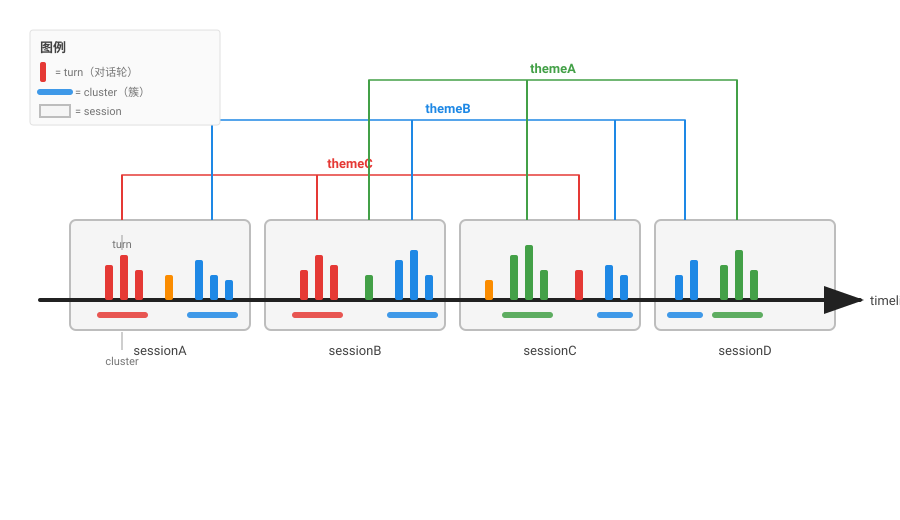

<div align="center">
  <picture>
    <source media="(prefers-color-scheme: dark)" srcset="./assets/banner-dark.svg" />
    <source media="(prefers-color-scheme: light)" srcset="./assets/banner-light.svg" />
    
  </picture>

  **为 Kimi Code CLI 装上跨会话的长期记忆 —— Markdown 优先、可审计、由你拥有**

  [English](./README.en.md) · [文档](./docs/ARCHITECTURE.md) · [演示](#演示) · [问题反馈](https://github.com/Zehee/kimi-code-memory-mcp-server/issues)

  [](https://github.com/Zehee/kimi-code-memory-mcp-server/actions/workflows/ci.yml)
  [](https://www.npmjs.com/package/kimi-code-memory-mcp-server)
  [](https://www.npmjs.com/package/kimi-code-memory-mcp-server)
  [](https://nodejs.org/)
  [](./LICENSE)
</div>

一个为 [Kimi Code CLI](https://github.com/MoonshotAI/kimi-code) 提供跨会话记忆的本地 stdio MCP 服务器。

## 30 秒上手

```bash
npm install -g kimi-code-memory-mcp-server
kimi-memory-setup
```

重启 `kimi web`，你的 Agent 从此拥有跨会话记忆：决策、规则、知识自动沉淀，换会话不丢失；浏览器还会自动打开记忆仪表盘，随时查看 Agent 记住了什么。更多安装方式见 [安装](#安装)。

## 演示

真实的 Kimi Code CLI 会话：用户先后要求总结 MCP 记忆服务器与 E2E 测试工具的演进历史，Agent 跨会话召回相关记忆与对话轮次，生成结构化总结。


`kimi-memory` 眼中的对话历史：竖条是时间轴上的轮次（turn），粗横线是簇，灰框是会话，彩色括号把跨会话的相关轮次串联成主题线。




## 特性

- **Markdown 优先** —— 记忆可读、可编辑、可用 git 审计，不由黑盒数据库托管。
- **结构化长期记忆** —— 分类保存决策、规则、知识与参考，并提炼工作区精要。
- **跨会话恢复** —— 直接读取 Kimi Code CLI 的 `wire.jsonl`，找回近期工作上下文。
- **主题追溯** —— 把散落在多个会话中的相关轮次重新串联，还原设计与决策的演化。
- **本地且可重建** —— Markdown 是真相源，索引只是缓存；无需外部数据库或云服务。
- **可视化仪表盘** —— 随 MCP 自动启动，浏览记忆、主题时间线和近期决策，支持中英文界面。

## 使用示例

配置完成后，直接用自然语言与 Agent 交互：

```text
用户：我们决定用 SQLite 作为缓存层，记住这个决策。
Agent：[remember] 保存到 memory/decisions/

用户：我们之前为什么选 SQLite？
Agent：[search + recall] “因为项目需要本地离线运行，并避免引入额外服务……”

用户：缓存设计是怎么演化的？
Agent：[trace_theme] 汇总跨会话的相关讨论、决策与调整
```

## 为什么是 Kimi Memory？

### 不只记住最近，还能追溯来龙去脉

传统上下文管理按时间纵向衰减；真实工作却常常是多条主题线并行。主题追溯会横向扫描历史会话，将同一主题的对话轮次与记忆重新关联。三周后升级登录模块时，Agent 能找到最初的方案、中途的调整和当前结论，而不是让你重新解释一遍。

完整设计见 [`docs/design-story.md`](./docs/design-story.md)。

### 记忆应该透明，并由你拥有

记忆在写入前经过判断与结构化，以 Markdown + YAML frontmatter 保存。你可以直接阅读、编辑、搜索和 `git diff`，也可以在任何能读取文本的 LLM 中使用。架构与设计取舍见 [`docs/ARCHITECTURE.md`](./docs/ARCHITECTURE.md)。

## 安装

需要 Node.js ≥ 22.13（使用内置 `node:sqlite`，无需原生编译依赖）。常规安装只需运行首屏的两条命令；以下保留升级与高级配置。

### 升级

```bash
npm install -g kimi-code-memory-mcp-server@latest
kimi-memory-setup --force
```

升级后请重启 `kimi web` 或 CLI，让正在运行的 MCP 实例加载新版本。

<details>
<summary>自动配置详情与源码安装</summary>

`kimi-memory-setup` 会检测 `~/.kimi-code`，注入 `AGENTS.md` 记忆协议、安装 `memory-manage` Skill，并在 `mcp.json` 中注册 `kimi-memory` 服务器。

```bash
# 预览变更，不写入文件
kimi-memory-setup --dry-run

# 移除注入的配置
kimi-memory-setup --undo

# 未全局安装时，也可通过 npx 运行
npx -p kimi-code-memory-mcp-server kimi-memory-setup
```

从源码构建：

```bash
git clone https://github.com/Zehee/kimi-code-memory-mcp-server.git
cd kimi-code-memory-mcp-server
npm install
npm run build
```

</details>

<details>
<summary>手动配置 Kimi Code CLI</summary>

编辑 `~/.kimi-code/mcp.json`。通过 `npx` 运行时：

```json
{
  "mcpServers": {
    "kimi-memory": {
      "command": "npx",
      "args": ["-y", "kimi-code-memory-mcp-server"],
      "enabled": true
    }
  }
}
```

全局安装或从源码构建时，将 `command` 设为 `node`，并将 `args` 设为对应 `dist/server.js` 的绝对路径：

```json
{
  "mcpServers": {
    "kimi-memory": {
      "command": "node",
      "args": ["/absolute/path/to/kimi-code-memory-mcp-server/dist/server.js"],
      "enabled": true
    }
  }
}
```

> **Windows 原生二进制注意**：如果裸 `node` / `npx` 报 `spawn ... ENOENT`，请将 `command` 换成可执行文件的绝对路径。`kimi-memory-setup` 会自动生成绝对路径，推荐优先使用。

服务器名称必须保留为 **`kimi-memory`**，因为注入的规则通过 `mcp__kimi-memory__*` 调用工具。修改后重启 Kimi Code CLI。

</details>

<details>
<summary>故障排查</summary>

- **`spawn npx ENOENT` / `spawn node ENOENT`**：改用 Node 与 `dist/server.js` 的绝对路径，或运行 `kimi-memory-setup --force`。
- **改了 `mcp.json` 但 `/new` 后仍不生效**：连接失败会被当前进程缓存，需要重启 `kimi web` 或 CLI。
- **切换工作区后 MCP 不可用**：升级到 0.4.1+ 并重启，旧版本存在仪表盘端口竞态。
- **启动时弹出多个仪表盘窗口**：升级到 0.5.1+ 并重启；同一工作区现在只保留一个仪表盘实例，多个 MCP 进程自动复用，只打开一个浏览器窗口。
- **查看连接日志**：`~/.kimi-code/logs/kimi-code.log`。

</details>

## 可视化仪表盘

仪表盘默认随 MCP 服务器启动，地址为 `http://127.0.0.1:58628`；也可独立运行：

```bash
kimi-memory-vis
```

支持工作区精要编辑、记忆浏览、主题时间线、搜索视图管理和中英文切换。使用 `--port`、`--no-open` 或 `--workspace` 可自定义启动方式，也可让 Agent 调用 `open_memory_dashboard`。

仪表盘按工作区单例运行：Kimi Code 为同一工作区启动多个 MCP 进程时，只有第一个进程绑定端口并打开浏览器窗口，其余进程自动复用已有实例；不同工作区各自拥有独立仪表盘。设 `KIMI_MEMORY_AUTO_VIS=0` 可完全关闭自动启动。

## 参考信息

<details>
<summary>存储布局与环境变量</summary>

数据默认存储在 `~/.kimi-code-memory/<workspace-id>/`：

```text
workspace-a1b2c3d4/
├── index.json              # 可重建的元数据缓存
├── memory/                 # decisions / knowledge / rules / reference
├── essence/essence.md      # 工作区精要（建议 ≤15 KB）
├── notes/                  # 临时速记
├── themes/                 # 主题到轮次/记忆的引用
├── searches/               # 保存的搜索视图
└── refined/refined.sqlite  # 轮次级摘要
```

| 变量 | 用途 |
|------|------|
| `MEMORY_STORE_ROOT` | 覆盖默认存储根目录。 |
| `MEMORY_SESSIONS_ROOT` | 覆盖默认的 `~/.kimi-code/sessions` 路径。 |
| `KIMI_CODE_HOME` | 从 `<KIMI_CODE_HOME>/sessions` 读取会话。 |
| `KIMI_MEMORY_AUTO_VIS` | 是否自动启动仪表盘，默认开启。 |
| `KIMI_MEMORY_VIS_PORT` | 仪表盘起始端口，默认 `58628`，被占用时自动向后尝试。 |
| `KIMI_MEMORY_VIS_HOST` | 仪表盘绑定地址，默认 `127.0.0.1`。 |

</details>

<details>
<summary>工具、Prompts 与 Resources</summary>

| 工具 | 用途 |
|------|------|
| `remember` / `recall` / `delete` / `move` | 写入、读取、删除、移动记忆 |
| `search` / `list` / `list_tags` | 搜索与列出记忆或标签 |
| `organize_memories` / `sync_workspace_index` | 提炼工作区精要、重建索引 |
| `bootstrap_workspace` / `load_more_context` | 恢复工作区与更早的上下文 |
| `get_current_workspace` | 查看当前工作区 ID、cwd 与存储路径 |
| `search_context` / `load_turn_context` | 跨会话搜索、加载指定轮次 |
| `tag_theme` / `trace_theme` / `list_themes` / `delete_theme` | 管理并追溯主题 |
| `list_search_views` / `delete_search_view` | 管理保存的搜索视图 |
| `refine_session_turns` | 生成轮次级摘要 |
| `open_memory_dashboard` | 打开可视化仪表盘 |

| Prompt | 用途 |
|--------|------|
| `memory-decision-check` | 修改文件前检查相关历史决策 |
| `memory-theme-trace` | 追溯主题的跨会话演化 |
| `memory-session-summary` | 总结当前会话并建议相关主题 |

| Resource URI | 用途 |
|--------------|------|
| `memory://<folder>/<key>` | 读取一条 Markdown 记忆 |
| `theme://<theme>` | 读取主题关联摘要 |
| `essence://essence` | 读取工作区精要 |

</details>

<details>
<summary>手动安装 AGENTS.md 启动钩子与记忆 Skill</summary>

自动 setup 已包含这两步；仅手动安装时需要：

```bash
cp AGENTS.md ~/.kimi-code/AGENTS.md
cp -r skills/memory-manage ~/.kimi-code/skills/memory-manage
```

`AGENTS.md` 负责会话启动时的记忆恢复与行为协议，Skill 负责识别用户的记忆相关意图。请确保 MCP 服务器注册名为 `kimi-memory`，并保持 `AGENTS.md` 只包含记忆相关约定。

</details>

## 开发

```bash
git clone https://github.com/Zehee/kimi-code-memory-mcp-server.git
cd kimi-code-memory-mcp-server
npm install
npm run build
npm test
npm run lint
```

贡献指南见 [`docs/CONTRIBUTING.zh-CN.md`](./docs/CONTRIBUTING.zh-CN.md)。

## 项目结构

```text
src/
├── server.ts              # MCP 服务器入口
├── config.ts              # 默认值与路径
├── setup-cli.ts           # kimi-memory-setup 自动配置 CLI
├── vis-cli.ts             # kimi-memory-vis 仪表盘 CLI
├── theme-manager.ts       # 主题存储
├── refined-manager.ts     # 精炼轮次存储（node:sqlite）
├── dao/                   # index.json DAO（v3-kv）与 Markdown 文件操作
├── context/               # wire.jsonl 解析与上下文恢复
├── refine/                # 轮次提炼：提取器、存储、适配器
├── tools/                 # 工具 schema 与分发（记忆/上下文/主题/系统）
├── prompts/               # MCP prompts
├── resources/             # MCP resources
├── vis/                   # 仪表盘：Hono API、自动启动、静态前端
└── utils/                 # frontmatter、搜索、路径、校验等
```

## 路线图

- [x] 模块化源码结构
- [x] ESLint + Prettier
- [x] 基础集成测试
- [x] 上下文/主题工具核心测试覆盖
- [ ] 可选本地 embedding 搜索
- [ ] 可选 LLM 精炼轮次
- [ ] 可插拔 wire 格式适配器
- [ ] 内存使用 benchmark

## 相关文档

- [`docs/ARCHITECTURE.md`](./docs/ARCHITECTURE.md) —— 系统设计与数据流
- [`docs/three-layer-memory-model.zh-CN.md`](./docs/three-layer-memory-model.zh-CN.md) —— 本服务器背后的记忆模型理论
- [`docs/search-logic.zh-CN.md`](./docs/search-logic.zh-CN.md) —— `search` 与 `search_context` 的实现逻辑
- [`docs/CONTRIBUTING.zh-CN.md`](./docs/CONTRIBUTING.zh-CN.md) —— 如何贡献

## 许可证

MIT
