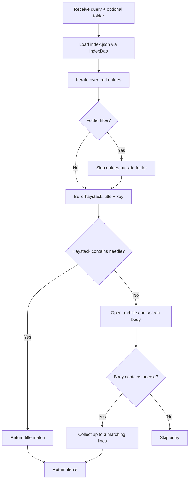
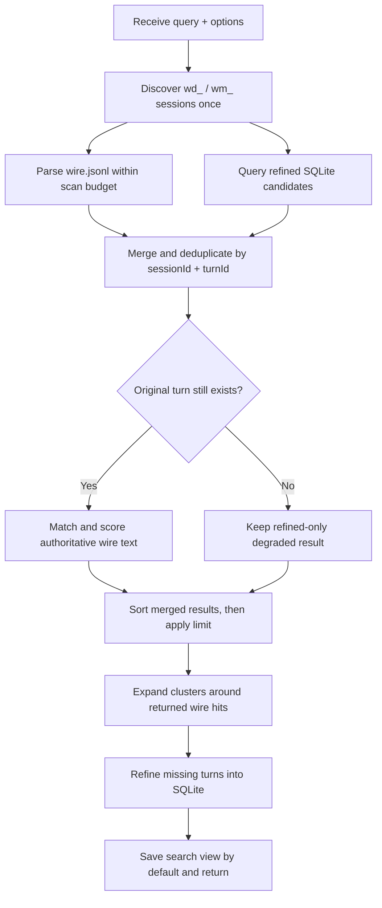

# Search Logic

The project provides two search tools with different scopes and implementations:

- `search` — searches across persisted Markdown memories.
- `search_context` — searches across Kimi Code CLI session wires (`wire.jsonl`).

---

## 1. `search` — Memory Search

Source: `src/tools/memory-tools.ts` (`handleSearch`)

### Flow



### Key behavior

- The query is converted to lowercase and matched against a lowercased haystack.
- Matching is **title/key first, body fallback**.
- When the body matches, up to 3 matching lines are returned as snippets.
- Results are not ranked by score; they appear in `index.json` iteration order.

### Example result

```json
{
  "items": [
    {
      "key": "use-sqlite-cache",
      "folder": "memory/decisions",
      "title": "Use SQLite for Cache",
      "matches": ["We chose SQLite over Redis because..."]
    }
  ]
}
```

---

## 2. `search_context` — Cross-Session Wire Search

Sources:

- Entry point: `src/tools/context-tools.ts` (`handleSearchContext`)
- Core search: `src/context/wire-context.ts` (`searchWireContext`)
- Refined storage: `src/refined-manager.ts` (`searchRefinedTurns`)

### Flow



### Merged retrieval

`searchWireContext` does not return early when refined data has hits. It merges both sources:

- **Wire is authoritative**: implicit (`wd_`) and managed (`wm_`) sessions are discovered once per request, and the original text is matched and scored again. A refined hit cannot hide an unrefined raw match.
- **Refined data fills missing originals only**: a summary is returned with `source: "refined-only"` only when its original turn no longer exists. Each `(sessionId, turnId)` appears at most once.
- **Shared semantics**: the query is split into lowercase terms and every term must match (AND). Merged results are stably ordered by score, timestamp, sessionId and turnId before `limit` is applied (default 10, maximum 100).
- **Bounded downstream work**: only returned wire matches participate in clustering and refinement, so work does not expand to every pre-limit hit.

### Partial scans and resumption

A request scans at most 32 MiB of wire data by default; `KIMI_MEMORY_MAX_SCAN_BYTES` overrides this budget. When the budget is exhausted, the refined row limit is reached, or refined rows are corrupt:

- the response contains `isComplete: false` and an explicit `truncationReason`;
- unscanned sessions appear in `skippedSessionIds`, and the first unfinished session becomes `nextCursor`;
- no unprovable `totalMatches` is reported; `matchCount` describes only the merged results actually discovered.

Passing `nextCursor` as the next call's `cursor` resumes at the first unfinished session. Cursor pages neither repeat refined-only rows from the first page nor report a global `totalMatches`. An invalid cursor returns an `invalid-cursor` error and does not save an empty view.

### Clustering, refinement and search views

Back in `handleSearchContext`:

1. **Group hits by session**. Only wire-backed hits participate in clustering, reusing paths from the discovery pass instead of rediscovering sessions; refined-only matches remain standalone results.
2. **Expand clusters**: for each hit, absorb nearby turns within `cluster_gap_seconds` (default 90s), up to `max_cluster_size`.
3. **Refine missing turns**: turns inside clusters that are not yet in SQLite are passed to `refinedManager.refineTurn()` and saved in batch.
4. **Save views**: `save_view` defaults to `true`, and new views use `search-v2-<32hex>` IDs. Set it to `false` for a read-only search. Legacy IDs remain readable and safely deletable.
5. **Return** fields including `matches`, `clusters`, `matchCount`, `isComplete`, `skippedSessions`, `refinedCount` and `savedViewKey`.

### Example result

```json
{
  "query": "SQLite cache",
  "totalMatches": 2,
  "matchCount": 2,
  "returnedMatches": 2,
  "isComplete": true,
  "matches": [
    { "sessionId": "session_xxx", "turnId": 5, "score": 3, "source": "wire", "user": "...", "agent": "..." }
  ],
  "clusters": [
    { "sessionId": "session_xxx", "hitTurnId": 5, "memberCount": 3, "members": [...] }
  ],
  "skippedSessions": [],
  "refinedCount": 1
}
```

---

## Comparison

| Dimension   | `search`                    | `search_context`                                               |
| ----------- | --------------------------- | -------------------------------------------------------------- |
| Target      | Markdown memory files       | Kimi Code CLI `wire.jsonl` sessions                            |
| Index       | `index.json` 3-kv           | Authoritative wire scan + `refined/refined.sqlite` merge       |
| Matching    | Substring in title/key/body | Wire text or refined-only summaries with shared AND semantics  |
| Ranking     | None                        | Stable merged order by score, timestamp, sessionId and turnId  |
| Clustering  | No                          | Yes, around returned wire hits                                 |
| Side effect | None                        | Writes refined turns to SQLite; saves a search view by default |

---

## Environment variables that affect search

| Variable                     | Impact                                                                                     |
| ---------------------------- | ------------------------------------------------------------------------------------------ |
| `MEMORY_STORE_ROOT`          | Changes where `index.json` and `refined/refined.sqlite` are located.                       |
| `MEMORY_SESSIONS_ROOT`       | Changes where `search_context` looks for `wire.jsonl` files.                               |
| `KIMI_CODE_HOME`             | Alternative to `MEMORY_SESSIONS_ROOT`; sessions are read from `<KIMI_CODE_HOME>/sessions`. |
| `KIMI_MEMORY_MAX_SCAN_BYTES` | Overrides the per-request wire scan budget (32 MiB by default).                            |
| `KIMI_MEMORY_SESSION_ID`     | Manual/test-only current-session override; the Kimi host does not inject it automatically. |
