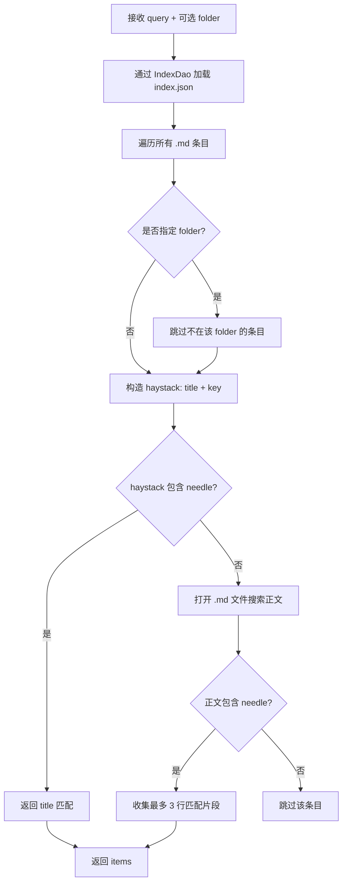
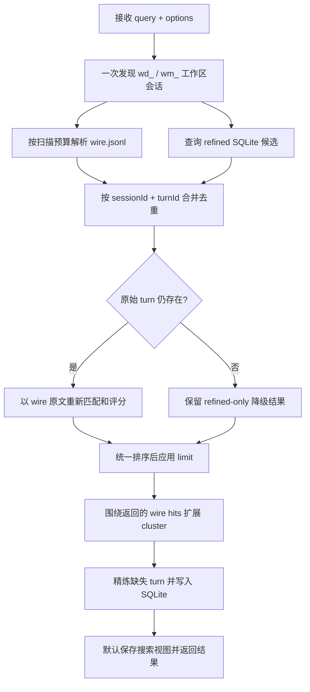

# 搜索逻辑

本项目提供两个搜索工具，作用域和实现各不相同：

- `search` —— 在持久化的 Markdown 记忆文件中搜索。
- `search_context` —— 在 Kimi Code CLI 的会话 wire（`wire.jsonl`）中搜索。

---

## 1. `search` —— 记忆搜索

源码：`src/tools/memory-tools.ts`（`handleSearch`）

### 流程



### 关键行为

- query 被转小写，与同样小写化的 haystack 做子串匹配。
- 匹配策略是**标题/key 优先，正文兜底**。
- 正文命中时，返回最多 3 行包含关键词的片段。
- 结果没有打分排序，按 `index.json` 的遍历顺序返回。

### 返回示例

```json
{
  "items": [
    {
      "key": "use-sqlite-cache",
      "folder": "memory/decisions",
      "title": "Use SQLite for Cache",
      "matches": ["We chose SQLite over Redis because..."]
    }
  ]
}
```

---

## 2. `search_context` —— 跨会话历史搜索

源码：

- 入口：`src/tools/context-tools.ts`（`handleSearchContext`）
- 核心搜索：`src/context/wire-context.ts`（`searchWireContext`）
- 精炼存储：`src/refined-manager.ts`（`searchRefinedTurns`）

### 流程



### 合并检索

`searchWireContext` 不会因 refined 已命中而提前返回，而是合并两个来源：

- **wire 是权威来源**：每次请求发现一次当前工作区的 implicit（`wd_`）和 managed（`wm_`）会话，扫描原文并重新匹配、评分；refined 命中不会遮住尚未精炼的原文命中。
- **refined 只补齐缺失原文**：只有原始 turn 已不存在时，才返回 `source: "refined-only"` 的摘要结果；同一 `(sessionId, turnId)` 不重复返回。
- **统一语义**：query 拆成小写关键词，所有关键词必须同时命中（AND）。合并后按 score、timestamp、sessionId、turnId 稳定排序，再应用 `limit`（默认 10，最大 100）。
- **工作范围受控**：只有返回的 wire matches 参与后续聚类和精炼，避免因为 `limit` 之前的全部命中而扩大写操作。

### 部分扫描与续扫

单次 wire 扫描默认最多读取 32 MiB，可用 `KIMI_MEMORY_MAX_SCAN_BYTES` 调整。预算不足、refined 行数受限或 refined 行损坏时：

- 返回 `isComplete: false` 和明确的 `truncationReason`；
- 预算未覆盖的 session 列入 `skippedSessionIds`，第一个未完成 session 作为 `nextCursor`；
- 不返回无法证明的 `totalMatches`；`matchCount` 只表示本次实际发现的合并结果数。

把 `nextCursor` 作为下一次调用的 `cursor` 可从第一个未完成 session 继续。cursor 页不重复返回第一页的 refined-only 结果，也不报告全局 `totalMatches`；失效游标返回 `invalid-cursor` 错误且不保存空视图。

### 聚类、精炼与搜索视图

回到 `handleSearchContext`：

1. **按 session 分组 hits**。只有存在 wire 的 hit 参与 cluster，并复用搜索阶段发现的 wire 路径，不重新发现会话；纯 refined 命中作为独立结果返回。
2. **扩展 cluster**：对每个命中点，吸收 `cluster_gap_seconds`（默认 90 秒）内的相邻 turn，最多 `max_cluster_size` 个。
3. **精炼缺失 turn**：cluster 中尚未写入 SQLite 的 turn 会批量传给 `refinedManager.refineTurn()` 并保存。
4. **保存视图**：`save_view` 默认是 `true`，新视图使用 `search-v2-<32hex>` ID；传 `false` 可执行只读搜索。legacy ID 仍可读取和安全删除。
5. **返回** `matches`、`clusters`、`matchCount`、`isComplete`、`skippedSessions`、`refinedCount`、`savedViewKey` 等字段。

### 返回示例

```json
{
  "query": "SQLite cache",
  "totalMatches": 2,
  "matchCount": 2,
  "returnedMatches": 2,
  "isComplete": true,
  "matches": [
    { "sessionId": "session_xxx", "turnId": 5, "score": 3, "source": "wire", "user": "...", "agent": "..." }
  ],
  "clusters": [
    { "sessionId": "session_xxx", "hitTurnId": 5, "memberCount": 3, "members": [...] }
  ],
  "skippedSessions": [],
  "refinedCount": 1
}
```

---

## 对比

| 维度     | `search`               | `search_context`                                      |
| -------- | ---------------------- | ----------------------------------------------------- |
| 搜索对象 | Markdown 记忆文件      | Kimi Code CLI `wire.jsonl` 会话                       |
| 索引     | `index.json` 3-kv      | wire 原文扫描 + `refined/refined.sqlite` 合并补齐     |
| 匹配方式 | title/key/正文子串匹配 | wire 原文或 refined-only 摘要，统一 AND 语义          |
| 排序     | 无                     | 合并后按 score、timestamp、sessionId、turnId 稳定排序 |
| 聚类     | 无                     | 围绕返回的 wire 命中点扩展 cluster                    |
| 副作用   | 无                     | 精炼 turn 写入 SQLite；默认保存搜索视图               |

---

## 影响搜索的环境变量

| 变量                         | 影响                                                                         |
| ---------------------------- | ---------------------------------------------------------------------------- |
| `MEMORY_STORE_ROOT`          | 改变 `index.json` 和 `refined/refined.sqlite` 的位置。                       |
| `MEMORY_SESSIONS_ROOT`       | 改变 `search_context` 查找 `wire.jsonl` 的位置。                             |
| `KIMI_CODE_HOME`             | `MEMORY_SESSIONS_ROOT` 的替代方案；会话从 `<KIMI_CODE_HOME>/sessions` 读取。 |
| `KIMI_MEMORY_MAX_SCAN_BYTES` | 覆盖单次请求的 wire 扫描字节预算，默认 32 MiB。                              |
| `KIMI_MEMORY_SESSION_ID`     | 仅用于手工或测试时固定当前 session；Kimi 宿主不会自动注入。                  |
